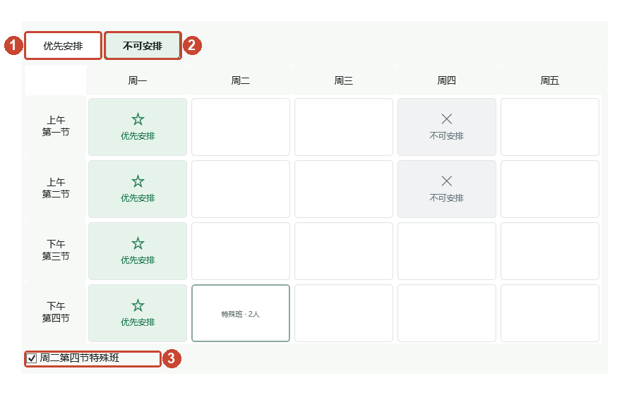
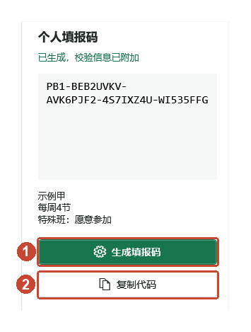
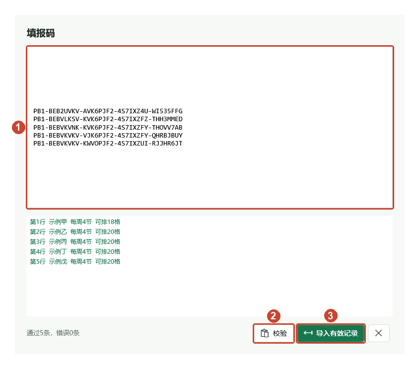
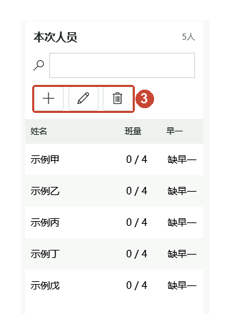

# 值班系统

离线使用的 Windows 值班排班工具，分为意愿填写和管理员排班两个程序。无需服务器或数据库。填写端生成代码，管理员导入后排班、人工调整并导出 Excel。

本页介绍两个程序的日常操作。所有截图均使用“示例甲”等虚构人员及演示意愿，不对应实际人员；不要照抄截图中的填报码。

**源码使用者：** 本仓库不附带已编译的 exe。先按文末“开发与构建”生成程序，再按下列步骤操作。

## 打开程序

| 使用者 | 打开位置 |
| --- | --- |
| 填报同学 | `意愿填写系统` 文件夹中的 `意愿填写系统.exe` |
| 排班管理员 | `排班系统` 文件夹中的 `排班系统.exe` |

换电脑时，复制对应的整个程序文件夹，不要只复制 exe。两个程序可以分开使用。

## 同学填写意愿

### 1. 填写姓名和每周班量

在图中 **1** 的姓名框填写本人姓名，在 **2** 选择每周“3节”或“4节”。


### 2. 标记时间

普通时间格留白就表示可以安排，不需要逐个勾选。只标记希望优先安排或不能安排的时间。



| 需要的操作 | 点击方法 |
| --- | --- |
| 优先安排 | 点图中 **1**“优先安排”，再点时间格 |
| 不能安排 | 点图中 **2**“不可安排”，再点时间格 |
| 取消标记 | 对已标记的格子，用相同标记再点一次，恢复留白 |
| 改成另一种标记 | 先换标记，再点格子，原标记会被直接覆盖 |
| 连续设置 | 按住鼠标拖刷多个时间格 |
| 整行或整列设置 | 点“周一”等列头，或“上午第一节”等行头；相同标记已全部选中时再点可批量取消 |

**特殊班：** 周二第四节默认不参加。愿意参加时勾选图中 **3**，或在周二第四节取消“不可安排”标记，两处会同步。取消该格的优先标记后仍参加，标为“不可安排”才退出。

填错时，用右上角的左弯箭头撤销，右弯箭头重做。垃圾桶用于清空本次填写。

### 3. 生成并发送填报码

1. 检查姓名、每周班量、时间格和特殊班选择。
2. 点图中 **1**“生成填报码”，核对右侧显示的信息。
3. 点图中 **2**“复制代码”，在聊天窗口粘贴，把完整代码发给管理员。



修改过姓名或意愿后，重新点“生成填报码”和“复制代码”，把新代码发给管理员，并说明“请以这条为准”。

不要把一条代码拆成多条消息发送。关闭填写系统前，先确认代码已经发送；重新打开不会保留刚才填写的内容。

## 管理员收集与排班

### 1. 导入填报码

1. 打开排班系统，点左上角“导入填报码”。
2. 把代码粘贴到图中 **1** 的大框内，每条代码独占一行。
3. 点图中 **2**“校验”，查看下方每一行的结果，确认姓名和班量。
4. 点图中 **3**“导入有效记录”，回到排班工作台。



有错误的行，请对应同学重新复制完整代码。正确的记录可以先导入，修正后的代码稍后再补。

同名内容有变化时会询问是否替换，先核对是不是同一位同学，再确认。

### 2. 核对人员并开始排班

1. 在左侧核对姓名和人数。
2. 确认本次代码已经收齐，再勾选图中 **1**“已确认记录收齐”。
3. 按需选择“计算时限”，点图中 **2**“自动排班”，等待结果。计算中可用旁边的停止图标取消。


搜索框可查找姓名。人员区图中 **3** 的加号用于新增，铅笔用于编辑，垃圾桶用于删除选中记录。



班量和早一情况在排班后核对；刚导入时显示尚未安排属于正常情况。

编辑或删除填报记录会清空当前排班，确认修改后重新点“自动排班”。误操作可用顶部左弯箭头撤销。

**注意区分：** 人员区的垃圾桶只删除选中人员；顶部垃圾桶会清空本次全部人员和排班。

### 3. 查看结果和手动调整

先看每个时间格的姓名，再核对人员列表中的“班量”和“早一”。周二第四节有上下两个岗位；“无”表示该岗位没有排到人。


1. 点课表中的岗位，在菜单中选择人选。不能选的人名可悬停查看提示。
2. 需要移除该岗位的人时，选菜单顶部“无（清空岗位）”。
3. 也可以从左侧名单把人拖入岗位。交换两位已排人员时，把一个岗位的姓名拖到另一个岗位。
4. 改错了，点顶部左弯箭头撤销，右弯箭头重做。调整后重新查看提醒。


人工调整完成后直接生成 Excel 即可。再次点“自动排班”会重新生成整张课表。

### 4. 处理提醒并生成 Excel

右侧显示“检查与提醒”。窗口较窄时，点下一张按钮图中 **1** 的三角提醒图标打开提醒列表。点一条提醒，可定位相关人员或时间格。


1. 根据提醒核对缺员、个人班量和早一。需要变更意愿时，编辑该同学或重新收集代码，再重新排班。
2. 确认当前结果可以使用后，点图中 **2**“生成 Excel”。
3. 如出现“带提醒导出”，先读清提醒。接受当前草案就点“是”，需要继续调整就点“否”。
4. 导出完成后，按提示点“是”打开输出文件夹，也可手动打开排班系统旁的 `输出` 文件夹。


生成的文件以系统时间加“排班表”命名，例如 `20261024_090000_排班表.xlsx`。打开后核对姓名、特殊班两人位置及“无”和提醒备注。输出目录不可写时，可为本次操作选择其他目录。

## 使用结束前

- 同学先发送填报码，再关闭填写系统。
- 管理员先生成 Excel，再关闭排班系统。
- 关闭后，本次导入、排班和撤销记录都会清空；已生成的 Excel 会保留。
- 保留程序目录中的 `排班模板.xlsx`，不要删除或覆盖。
- “自动排班”不能点时，先导入至少一条有效记录。
- “生成 Excel”不能点时，先完成排班。

## 常见问题

| 情况 | 处理方法 |
| --- | --- |
| 改了选择，管理员看到的还是旧内容 | 重新生成并发送新代码，说明以新代码为准 |
| 代码校验失败 | 重新复制完整代码，每条独占一行 |
| 课表中出现“无” | 查看提醒，核对人员和可排时间，按需补充或调整 |
| 有提醒但仍需要导出 | 读清“带提醒导出”后确认，导出的草案仍会保留提醒 |
| 重开程序后没有记录 | 属于正常情况，需要重新导入代码 |
| 换电脑后打不开 | 确认复制了整个程序文件夹，而不是只有 exe |

## 开发与构建

开发机需要 Windows x64、.NET 10 SDK 和 PowerShell 7。在 `开发源码` 目录执行：

```powershell
.\tools\build.ps1
dotnet run --project .\tests\Duty.Tests\Duty.Tests.csproj -c Release
.\tools\verify-portable.ps1 -RunLabel public_check
```

构建会在项目根目录生成 `意愿填写系统` 与 `排班系统` 两个自包含程序目录。迁移时复制整个对应文件夹，不要只复制 exe。运行端不需要安装 SDK。Windows 11 已做本机验证，Windows 10 仍需在目标机器验收。

技术说明见 [开发说明](开发源码/README.md)，简明操作说明见 [使用说明](使用说明.md)，公开范围见 [公开发布检查](公开发布检查.md)。

## 公开与隐私

所有示例人员均为虚构。姓名由使用者每次填写，普通使用不保存填报或排班会话；导出的 Excel 会保留在本机。填报码包含姓名和意愿，是可逆编码，不是加密，请只发给负责收集的人，不要发布真实代码或真实排班表。

`.gitignore` 用于防止后续误加入运行数据、缓存、密钥和生成表格；它不能清除已经提交的历史。请仅从本目录创建新的公开仓库，不要把原工作目录整体上传。

## 许可证

项目自有代码与文档采用 [MIT License](LICENSE)。署名使用项目贡献者，不包含真实姓名或私人邮箱。

第三方版权和许可声明按原文保留，仍适用其各自许可，不属于本项目使用者的私人资料。正式发布可执行程序前，还需完成依赖说明中标注的再分发核验。
